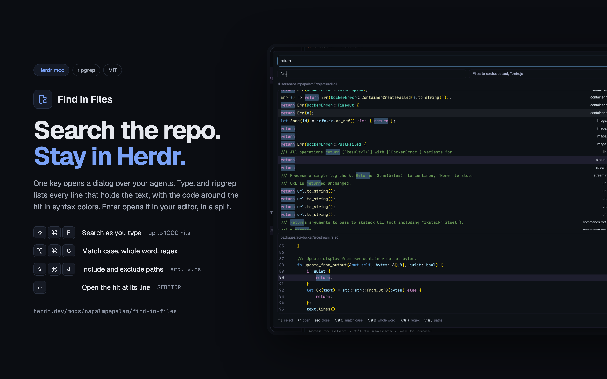

# Find in Files

A [Herdr](https://herdr.dev) mod that searches the repo of the focused
terminal for text, like JetBrains' Find in Files. It shows a dialog with a
query input, the list of hits, and a preview of the selected hit's lines.

## What it does

- **Search as you type.** The mod runs
  `rg --json --fixed-strings --smart-case` from the git root of the focused
  terminal (or its folder outside a repo), 150 ms after the last keystroke.
  By default the search is for literal text. A query with no capital letters ignores
  case. Like rg, it skips files that `.gitignore` names, hidden files and
  binary files. The list shows up to 1000 hits.
- **Options.** Three toggles at the right end of the query box change the
  search, and each one has a key:

  | Toggle     | Key | Off                             | On                                               |
  | ---------- | --- | ------------------------------- | ------------------------------------------------ |
  | Match case | ⌥⌘C | smart case, as above            | case always counts (`-s`)                        |
  | Whole word | ⌥⌘B | the query can be part of a word | only a whole word matches (`-w`)                 |
  | Regex      | ⌥⌘R | the query is literal text       | the query is a Rust regex (`--no-fixed-strings`) |

  A bad regex shows rg's reason in red under the query. A line at the bottom
  of the dialog lists the keys.

- **Path filters.** The filter toggle at the end of the query box, or
  **⇧⌘J**, shows two fields under the query: files to include and files to
  exclude. Each field takes globs separated by commas, like
  `src, *.js, *.{ts,tsx}`, and each glob becomes an rg `--glob` (an exclude
  adds `!`, and it wins over an include). A plain name like `test` matches
  a file or a folder of that name at any depth; a plain path like
  `src/lib` matches from the root. A leading `./` is dropped, and so is a
  trailing `/` on a plain name. Globs count case. A glob like `*.js` does
  not reach into a folder that `.gitignore` names or a hidden one, such as
  `node_modules/`. A plain name does: `node_modules` in include searches
  it. The fields hide only while both are empty.

- **Hits** show the line with each match marked, then the file name, the
  line number and the folder.
- **Preview.** The selected hit's line and five lines above and below it.
- **Syntax colors** in the hits and the preview, picked by the file
  extension, in VS Code's Dark+ colors (Light+ in a light theme). Keywords
  that declare or import (`const`, `fn`, `import`) and keywords that branch,
  loop or jump (`if`, `for`, `return`) get different colors. Names,
  brackets and ALL_CAPS constants have colors too. The preview
  colors a file from its first line, so a block comment that starts above the
  preview shows as a comment. A hit row colors only the part of its line that
  it shows, so a row inside a block comment or a multi-line string shows as
  code. A line colors its first 48 parts and its first 600 characters.
- **Keys.** **↑/↓** move the selection, a click selects a hit, **Enter**
  (in the query or a path field) opens the hit in `$EDITOR` (`nvim` when
  it is not set; a command with arguments, like `code --wait`, works too)
  at its line, in a split to the right of the focused pane. **Esc** closes
  the dialog.
- **The last query stays.** The dialog opens with the last query selected,
  so typing replaces it, and searches it again at once. The options and the
  path fields stay too.

## Install

1. Run `scripts/install.sh`. It copies `mods/find-in-files/` into
   `~/.config/herdr-app/mods/` (or `$HERDR_APP_HOME/mods/`) and runs
   `herdr-app check` on the copy. Do not symlink the folder: Herdr loads a
   linked folder but never reloads it.
2. Bind a key in `keys.json`, for example in `global`:
   `"cmd-shift-f": "mod.open:find-in-files"`. The key also closes the
   dialog.

Or ask the agent in your Herdr window to add
`herdr.dev/mods/napalmpapalam/find-in-files`; the steps are in Herdr's
`AGENTS.md`. The agent also merges the key from `keys.json`.

The mod needs `rg` ([ripgrep](https://github.com/BurntSushi/ripgrep)) and
`git` on the `PATH` of the machine that the terminal runs on.

## Versions

The mod's version is the `version` field in `mods/find-in-files/mod.json`,
and each release has the tag `v<version>` in this repo. Version 0.4.0 was
last tested on Herdr 0.1.12 (`herdr-app` 0.1.12) with ripgrep 15.1.

## License

MIT, see [LICENSE](LICENSE). The syntax tokenizer is a copy of
herdr-reviewer's, under its own MIT license, and the toggle icons are
[Lucide](https://lucide.dev)'s, under the ISC license: see
[THIRD-PARTY-NOTICES](THIRD-PARTY-NOTICES).
