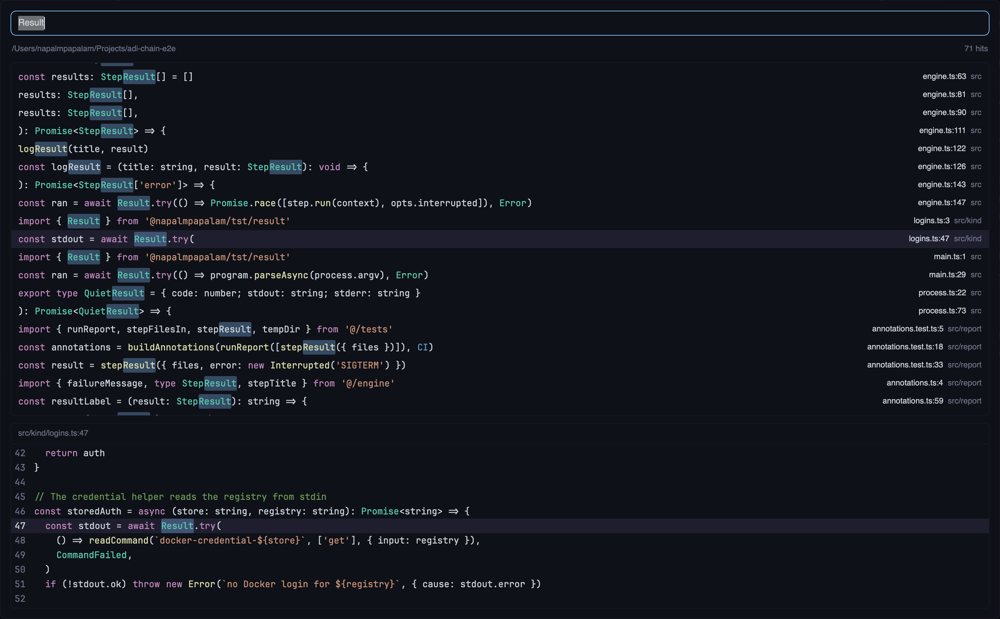

# find-in-files

A key opens a dialog over the window, like JetBrains' Find in Files. The
person types text. The dialog lists every line in the focused terminal's
repo that holds that text, and shows the selected line with five lines
above and below it, in syntax colors. Enter opens the hit in `$EDITOR` at
its line, in a split to the right of the focused terminal.

## What you see

A dialog, 75% of the window's width and 85% of its height (`overlay` in
`mod.json`), `surface` fill, 14px padding, 10px between the parts,
`foreground` text at 13px. Top to bottom:

- **Query input**, 36px tall, 10px left padding, 6px right, 8px corners, 1px
  `accent` border, `background` fill, 13px text. The placeholder is "Find
  in files…". The dialog opens with the last query in it, all selected.
  At its right end sit four toggles, 2px apart: Match case, Whole word,
  Regex and the path filter, each a 24px square with 5px corners and a
  16px Lucide icon (`case-sensitive`, `whole-word`, `regex`, `filter`). An
  option that is off draws its icon in `dim`; one that is on draws it in
  `accent` on an `accent` fill at `33` alpha. Under the pointer the icon
  turns `foreground`, and a tooltip names the option and its key, e.g.
  "Match case (⌥⌘C)", or "Files to include and exclude (⇧⌘J)". The filter
  toggle is on while the path fields show.
- **Path fields**, only while shown: two inputs side by side, 10px apart,
  each 30px tall, 10px side padding, 7px corners, 1px `border`,
  `background` fill, 13px text. The placeholders are "Files to include:
  src, *.js" and "Files to exclude: test, *.min.js".
- **Status line**, 11.5px: on the left the searched root (the full path,
  `dim`, cut with "…" when long); on the right "Searching…", "1 hit",
  "42 hits" or "1000+ hits", in `dim`. An rg error comes before the count,
  after " · ", in `blocked`: the stderr line that starts with `error:`
  (the reason of a bad regex), else the first line of stderr.
- **Hit list**, all the height that is left, 7px corners, 1px `border`,
  with a vertical scrollbar over its right edge. Rows are 26px, 10px side
  padding, 16px between the line and the location. A row shows:
  - the hit's line in the code font (`font` in settings, JetBrains Mono
    when unset), without its indent, cut at the right edge; when the first
    match is more than 60 characters in, the line starts 20 characters
    before it, after "…";
  - on the right, at 11.5px and at most 360px wide: `name.ext:line` in
    `foreground`, then the folder in `dim`, cut on the right.

  The selected row has the `selected` fill, the others `surface`, and
  `hover` under the pointer. Without hits the box shows, 12px in from its
  corner in `dim`: nothing while it searches, "No hits", or "Type to search
  <root>" for an empty query.

- **Preview**, a fixed height of 11 code lines plus a 30px head: 7px
  corners, 1px `border`, `background` fill. The head shows `path:line` at
  11.5px in `dim`, with a 1px `border` line under it. The code is one size
  under the terminal's font (`font_size` minus 1, at least 9px), lines
  1.6 times that tall. Each line has its number right-aligned in a gutter
  as wide as the largest number, 12px before the code, in `dim`. The hit
  line has the `selected` fill and its number in `foreground`. Every line
  starts at the same column, the one that brings the first match into
  view. Under the code: "Cannot read this file", or "Line N is not in the
  file now" when the file got shorter since the search.
- **Key hints**, 11.5px in `dim`, 14px apart, with 4px more above them so
  they sit midway between the preview and the dialog's edge: each key in
  `foreground`, then what it does: "↑↓ select", "↵ open", "esc close", "⌥⌘C match
  case", "⌥⌘B whole word", "⌥⌘R regex", "⇧⌘J paths".

**Matches** have an `accent` background at `55` alpha (hex) with 2px
corners, in rows and in the preview's hit line. **Syntax colors** are the
text color, picked from the file extension: VS Code's Dark+ in a dark
appearance (text `#d4d4d4`, keyword `#569cd6`, control keyword `#c586c0`,
string `#ce9178`, comment `#6a9955`, number `#b5cea8`, function `#dcdcaa`,
type `#4ec9b0`, boolean `#569cd6`, name `#9cdcfe`, constant `#4fc1ff`,
bracket `#ffd700`) and Light+ in a light one (`#000000`, `#0000ff`,
`#af00db`, `#a31515`, `#008000`, `#098658`, `#795e26`, `#267f99`,
`#0000ff`, `#001080`, `#0070c1`, `#0431fa`). A control keyword branches,
loops or jumps (`if`, `for`, `return`, `throw`, `await`; `fi` and `esac` in
shell). The lists in `syntax.js` are Zed's own for JS, Rust, Go, C/C++ and
shell, and a guess for Java, Ruby, PHP and Swift. Like Zed, a `default` not
followed by `:` and Rust's `for` in an `impl` header take the keyword
color. `import`, `export`, `this` and `self` take the keyword color too.
Python has no control color, and its `and`, `or`, `not`, `in` and `is`
keep the text color. SQL, CSS, HTML, YAML and JSON keep one keyword
color. A name is any other word in JS, Rust, Python, Go,
C, Java, Ruby, PHP and Swift; in shell a plain word is an argument and
keeps the text color. A constant is an ALL_CAPS word other than `NULL`,
`TRUE` and `FALSE`. Brackets are `()[]{}`, one color at every depth.
Operators and punctuation keep the text color, and so does a file with no
language. Rows and preview lines draw at most
300 characters; a tab draws as four spaces.

## How it behaves

- **Search:** 150 ms after the last keystroke, `rg --json --fixed-strings
--smart-case` runs in the git root of the focused terminal's folder (the
  folder itself outside a repo), on the terminal's machine. Literal text
  unless Regex is on; a query without capitals ignores case unless Match
  case is on. At most 1000 hits, sorted by path and then line. An empty
  query clears the list. A newer query drops the
  result of an older one that comes back late.
- **Options** add flags before the query: Match case `--case-sensitive`
  (it comes after the script's `--smart-case`, so it wins), Whole word
  `--word-regexp`, Regex `--no-fixed-strings` (rg's own regex syntax). A
  toggle searches again at once, without the 150 ms wait, and keeps the
  keyboard in the input that had it.
- **Path fields:** hidden at first, unless a field kept text. The filter
  toggle and ⇧⌘J show them and move the keyboard to the include field.
  They hide them only while both are empty, and give the keyboard back to
  the query; while a field has text, they move the keyboard to the include
  field instead. A change in a field searches after the same
  150 ms. Each field splits on the commas outside `{}`, trims each part,
  drops empty parts and a leading `./`. Each part becomes `--glob <part>`
  (exclude: `--glob !<part>`), the excludes after the includes so they
  win. A part without `* ? [ {` is a name: a trailing `/` is dropped, and
  it becomes two globs, `X` and `**/X/**` without a `/`, or `X` and
  `X/**` with one (rg anchors a glob with a `/` to the root). Globs are
  case-sensitive.
- **Keys:** ↓ and ↑ move the selection and scroll the list to keep it in
  the middle. A click selects a row without a scroll. Enter opens the
  selected hit, from the query or a path field. ⌥⌘C, ⌥⌘B and ⌥⌘R flip
  the three options; ⇧⌘J shows or hides the path fields. Esc closes
  the dialog, and so does the key that opened it.
- **Open:** Enter closes the dialog, then opens a terminal to the right of
  the focused one, in the root, that runs `${EDITOR:-nvim} +<line> <path>`.
- **Preview:** selecting a hit reads its file once per search and shows
  the hit line with five lines above and below. The preview colors the file
  from its first line, so a block comment that starts above the preview
  shows as a comment. A row colors only the part of its line that it shows.
- **The last query, the options and the path fields** stay after a close,
  also after Herdr restarts. They are global, not per repo.

## Built from

- `mod.json`: `"place": "none"`, `"overlay": { "kind": "dialog", "width":
0.75, "height": 0.85 }`. `keys.json` binds `cmd-shift-f` to
  `mod.open:find-in-files` in `global`.
- `herdr`: `props().overlay` and `closeOverlay`; `exec` for `git
rev-parse --show-toplevel` and the search; `readTextFile` for the preview;
  `focused`, `panes`, `spaces`, `home` for the folder and machine;
  `shared` / `setShared` for `"find-in-files.query"` and
  `"find-in-files.options"` (`{ matchCase, wholeWord, regex, include,
exclude }`); `theme`,
  `settings` (`font`, `font_size`, `dark`); `run("terminal.open", { argv,
folder, place: "right" })`.
- `gpui-base`: `InputState` + `Input`, `v_virtual_list` with a
  `VirtualListScrollHandle` and `on_item_click`, `Scrollbar.vertical`.
- `gpui-kit`: `svg(path)` for the icons, `.tooltip(text)` on the toggles.
- Programs: `sh`, `rg`, `grep`, `git`, and `$EDITOR`.
- `vendor/highlight.js`: the line tokenizer of
  [herdr-reviewer](https://github.com/vytasgavelis/herdr-reviewer) (MIT,
  license beside it), unmodified. `vendor/*.svg`: four
  [Lucide](https://lucide.dev) icons from `lucide-static` 0.460.0 (ISC,
  `vendor/lucide.LICENSE`), unmodified.

## Watch out

- It runs programs (`exec`: `sh`, `rg`, `git`; `terminal.open`: the
  editor) and reads files in the searched repo. It does not reach the
  network.
- rg's `submatches[].start/end` are UTF-8 byte offsets; JS strings index
  UTF-16 units. Convert them, or marks drift on non-ASCII lines.
  `--max-columns` has no effect on `--json`: long lines come whole.
- `exec` cannot be cancelled, keeps at most 8 MiB, and stops after 30 s.
  The search pipes rg into `grep -m 1001 '^{"type":"match"'`, so grep
  closes the pipe after the cap and rg stops.
- `$EDITOR` is not quoted, so `code --wait` splits into words. The path
  keeps rg's `./`, so a file named `-x` is not read as an option.
- `terminal.open` with `place: "right"` fails while a layout terminal
  block has focus.
- `props()` is null under `herdr-app check`: the mod then draws without
  wiring the input.
- Herdr gives a mod no close hook, and the close key never reaches the
  mod, so each search saves the query. Esc and Enter save it too. The
  options are saved the same way, but only after they change.
- rg matches nothing for a glob with a trailing `/`, and a glob with a
  `/` is anchored to the root (not to `./`), so `lib/**` misses `a/lib/`.
  One `--glob` takes one glob: `*.rs,*.js` in one flag matches nothing.
- A glob like `*.js` does not reach into an ignored or hidden folder: rg
  skips the folder before it tests the files. A plain name does: its bare
  `X` glob matches the folder itself, so `node_modules` or `.git` in
  include searches that folder.
- A bad regex makes rg exit 2 with no rows, and the pipe into grep hides
  the exit code. Line 1 of stderr is only "rg: regex parse error:"; the
  reason is on the line that starts with `error:`.
- A zero-width regex (`^`, `x*`) matches every line, with empty
  submatches: the list fills up to the cap and marks nothing.
- The tokenizer colors at most 24 spans and 600 characters of a line, and
  `syntax.js` at most 48 parts: each part is an element. A row tokenizes
  only what it shows, so a far match still has colors.
- `*.test.js` files are `bun test` tests next to their modules. Herdr never
  loads them; leave them out of the install.

## Done when

- `herdr-app check mods/find-in-files` passes.
- The key opens the dialog; typing a word in a repo lists its lines with
  the word marked, and the count matches the lines that `rg -F -S --count`
  finds (up to 1000).
- ↓/↑ move the tinted row and the preview follows, with line numbers and
  the hit line tinted.
- A `.js` or `.rs` hit shows keywords, strings and comments in their
  colors in the row and in the preview.
- Enter opens `nvim` (or `$EDITOR`) on the hit's line in a split to the
  right; Esc closes the dialog; opening it again shows the last query.
- ⌥⌘C on `foo` drops the `FOO` lines; ⌥⌘B drops `foobar`; ⌥⌘R on
  `fo+b` finds `foobar`, and on `foo(` shows "error: unclosed group" in
  red. A click on a toggle leaves the cursor in the query.
- ⇧⌘J shows the path fields; `*.md` in include lists only Markdown hits,
  `test` in exclude drops every hit under a `test/` folder, and the
  fields come back with their text after the dialog opens again.
  `node_modules` in include lists hits under `node_modules/`.
